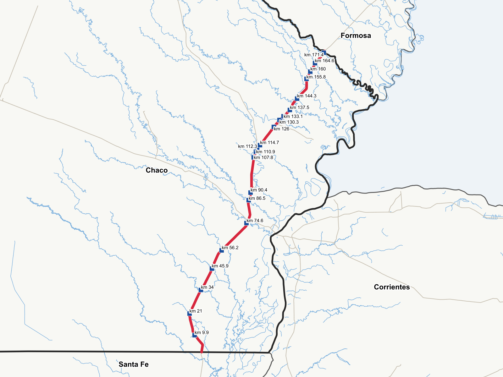

# Objetivo

El Ministerio de Planificación prevé obras de mantenimiento en la **Ruta Nacional 11 (RN 11)** dentro del Chaco. Para preparar los pliegos, la consigna b pide tres datos: cuántos kilómetros tiene la traza en la provincia, a cuánta gente afecta (hasta 10 km y de 10 a 20 km de la ruta, en categorías excluyentes) y cuántos puentes la cruzan.

Tabla: Respuestas a la consigna b

{{tabla_resumen}}

# Datos y herramientas

Se usaron las capas del **SIG IGN 250** (IGN, 2011) cargadas en PostGIS: provincias, red vial, localidades, puentes y cursos de agua. La población es el campo `canthab` de las localidades, que corresponde al Censo 2001 (INDEC, 2001).

Las capas vienen en grados (EPSG:4326), y en grados no se pueden medir kilómetros ni trazar un buffer en metros. Por eso todo se calcula en **POSGAR 2007 faja 5 (EPSG:5347)**, el marco oficial argentino en metros, cuyo meridiano central (60° O) pasa por el Chaco (IGN, s.f.).

El análisis se hizo en **QGIS 4.2** con las herramientas de **Procesamiento** (las de *Vectorial → Geoproceso*), escritas como un script de Python para poder repetirlo (`scripts/analisis_rn11_qgis.py`). QGIS lee las capas de PostGIS y guarda los resultados de nuevo en PostGIS, en el esquema `analisis`. Desde ahí GeoServer los publica y la aplicación web los muestra.

# Pasos

Cada paso indica la herramienta de QGIS que se usó y el código del script que la ejecuta.

## La traza

En la red vial hay dos rutas con el número 11: la nacional y una provincial distinta (RP 11). Se tomaron solo los tramos con `nro_ruta = '11'` y `administra = 'Nacional'`, se recortaron con el límite del Chaco y se unieron en una sola línea. Mide **{{km_traza}} km**, desde el límite con Santa Fe hasta el río Bermejo.

Herramientas: *Extraer por expresión*, *Cortar*, *Reproyectar capa*, *Disolver* y *Fusionar líneas*.

```python
rn11 = processing.run("native:extractbyexpression", {"INPUT": red_vial,
           "EXPRESSION": "\"nro_ruta\" = '11' AND \"administra\" = 'Nacional'"})
recorte = processing.run("native:clip", {"INPUT": rn11, "OVERLAY": chaco})
traza = processing.run("native:reprojectlayer", {"INPUT": recorte,
            "TARGET_CRS": "EPSG:5347"})              # POSGAR 2007 faja 5
traza = processing.run("native:mergelines", {"INPUT": disolver(traza)})
km = traza.geometry().length() / 1000                # 172,39 km
```

## Las áreas de 10 y 20 km

Como las categorías son excluyentes, nadie puede contarse dos veces. Se armaron dos áreas que no se superponen, recortadas al Chaco:

- **Hasta 10 km:** buffer de 10 km alrededor de la traza.
- **De 10 a 20 km:** el buffer de 20 km menos el de 10 km, que queda como un anillo.

Herramientas: *Buffer*, *Cortar* y *Diferencia*.

```python
b10 = processing.run("native:buffer", {"INPUT": traza, "DISTANCE": 10000,
                                       "DISSOLVE": True})
b20 = processing.run("native:buffer", {"INPUT": traza, "DISTANCE": 20000,
                                       "DISSOLVE": True})
area10 = processing.run("native:clip", {"INPUT": b10, "OVERLAY": chaco})
anillo = processing.run("native:difference", {"INPUT": recortar(b20, chaco),
                                              "OVERLAY": b10})   # el anillo
```


Figura: Áreas en QGIS: hasta 10 km (naranja) y de 10 a 20 km (amarillo).

## La población

Se eligieron las localidades que caen dentro de cada área y se sumó su población. Solo se cuentan las del Chaco, según el atributo `provincia`. No se usó el polígono porque General Mansilla, de Formosa, queda dentro del límite del Chaco sobre el río Bermejo.

Herramientas: *Extraer por atributo* y *Extraer por localización* (predicado "está dentro").

```python
del_chaco = processing.run("native:extractbyattribute", {"INPUT": localidades,
                "FIELD": "provincia", "OPERATOR": 0, "VALUE": "Chaco"})
loc10 = processing.run("native:extractbylocation", {"INPUT": del_chaco,
            "PREDICATE": [6], "INTERSECT": area10})   # 6 = está dentro
poblacion_10 = sum(f["canthab"] or 0 for f in loc10.getFeatures())  # 360.983
```

## Los puentes

La capa de puentes son puntos y no dice a qué ruta pertenece cada uno. Se consideró que un puente es de la RN 11 si está a **500 m o menos** de la traza y además su **camino más cercano es la RN 11**. Con eso se descartan 3 puentes de caminos vecinales cercanos. Cada puente se ubicó por su kilómetro sobre la traza y por el curso de agua que cruza.

Herramientas: *Extraer dentro de una distancia*, *Unir atributos por el más cercano* y *Extraer por expresión*.

```python
cerca = processing.run("native:extractwithindistance", {"INPUT": puentes,
            "REFERENCE": traza, "DISTANCE": 500})     # 24 puentes
unidos = processing.run("native:joinbynearest", {"INPUT": cerca,
             "INPUT_2": red_vial, "PREFIX": "via_",
             "FIELDS_TO_COPY": ["nro_ruta", "administra"]})
puentes_rn11 = processing.run("native:extractbyexpression", {"INPUT": unidos,
    "EXPRESSION": "via_nro_ruta = '11' AND via_administra = 'Nacional'"})  # 21
km = traza.lineLocatePoint(puente) / 1000            # kilómetro de cada puente
```



Figura: Puentes de la RN 11 en QGIS, rotulados con su kilómetro.

En el código se omite `["OUTPUT"]` y las funciones `disolver` y `recortar` resumen pasos con *Disolver* y *Cortar*; el script completo está en el repositorio.

# Resultados


Figura: La RN 11 en el Chaco con sus áreas de influencia, las localidades y los puentes.

## Población afectada

Tabla: Población afectada por categoría (solo Chaco)

{{tabla_poblacion}}

La obra afecta a **{{poblacion_total}} habitantes**, casi todos en el Gran Resistencia: la traza pasa a menos de 3 km del centro de la capital.

Tabla: Localidades del Chaco con dato de población

{{tabla_localidades}}

Las otras {{localidades_sin_dato}} localidades son parajes y colonias sin dato de población. Dentro de los 20 km también hay localidades de otras provincias, como la ciudad de Corrientes, que no se cuentan porque la obra es en el Chaco. Suman {{poblacion_fuera}} habitantes.

## Puentes

**{{puentes}} puentes** cruzan la traza:

Tabla: Puentes de la RN 11 en el Chaco, desde el límite con Santa Fe

{{tabla_puentes}}

Para verificar, se contaron los cruces de la ruta con los cursos de agua: son {{cruces}}. El del Río de Oro (km 141,7) no tiene un puente cargado en la capa del IGN.


Figura: Los resultados en el visor web, con el tema "Obra RN 11".

# Limitaciones

- La población es la del **Censo 2001**; con el Censo 2022 los valores serían mayores.
- Solo {{localidades_con_dato}} de las {{localidades_total}} localidades tienen dato, así que la población rural queda **subestimada**.
- Las localidades son puntos: una ciudad se cuenta entera en la categoría donde cae su punto.
- A escala 1:250 000, un puente en el cruce de dos rutas podría asignarse a la otra.

# Conclusión

La RN 11 recorre **{{km_traza}} km** en el Chaco. La obra afecta a **{{poblacion_0_10}} habitantes** hasta 10 km y a **{{poblacion_10_20}}** de 10 a 20 km, **{{poblacion_total}}** en total, concentrados en el Gran Resistencia. **{{puentes}} puentes** cruzan la traza. El análisis se hizo con las herramientas de Procesamiento de QGIS y se puede repetir con el script del proyecto.

# Referencias

- EPSG (s.f.). *EPSG:5347 – POSGAR 2007 / Argentina 5*. https://epsg.io/5347
- IGN – Instituto Geográfico Nacional (2011). *SIG IGN 250, escala 1:250 000*. https://www.ign.gob.ar/
- IGN – Instituto Geográfico Nacional (s.f.). *Marco de Referencia Geodésico Nacional POSGAR 2007*. https://www.ign.gob.ar/
- INDEC (2001). *Censo Nacional de Población, Hogares y Viviendas 2001*. https://www.indec.gob.ar/
- PostGIS (2025). *PostGIS 3.5 Manual*. https://postgis.net/docs/
- GeoServer (2025). *GeoServer 2.27 User Manual*. https://docs.geoserver.org/
- QGIS (2026). *QGIS User Guide: algoritmos de Procesamiento*. https://docs.qgis.org/
- UTN FRRe (2026). *Trabajo Práctico Integrador – Sistemas de Información Geográfica*. `docs/tpi/practico.pdf`.
