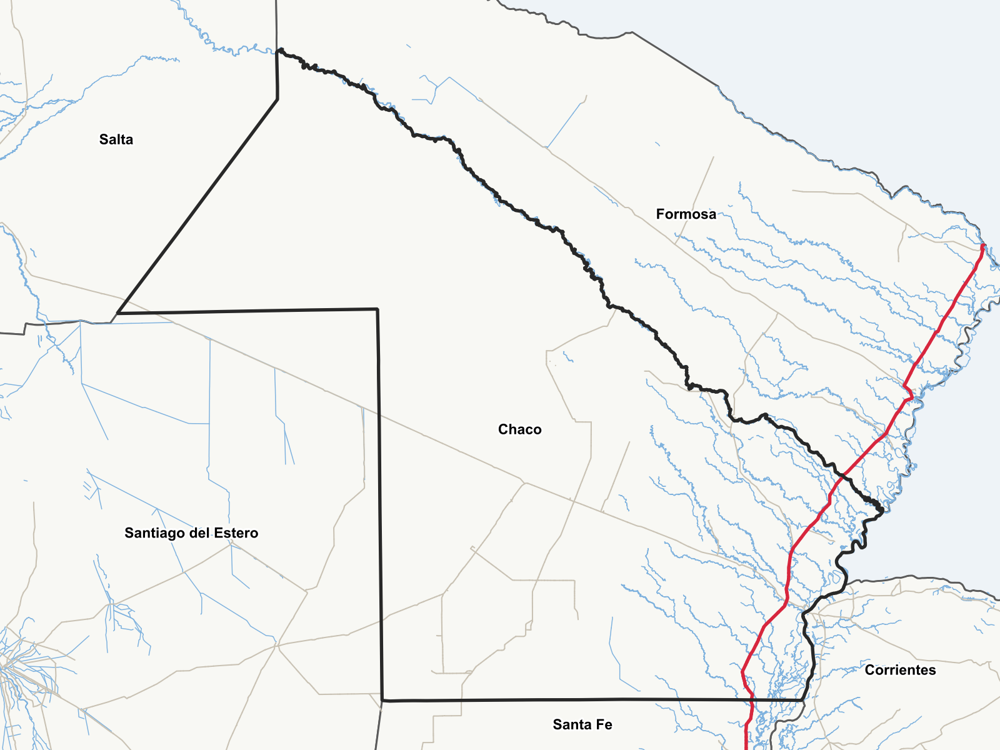
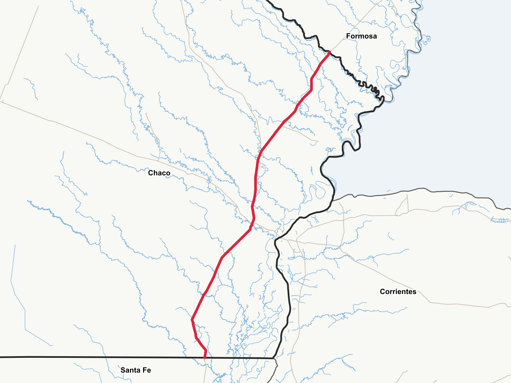
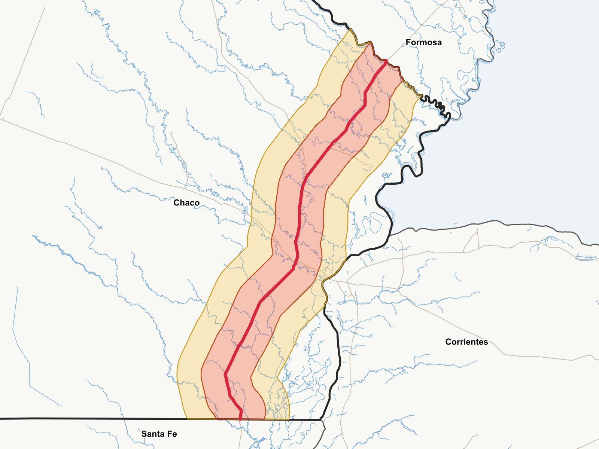
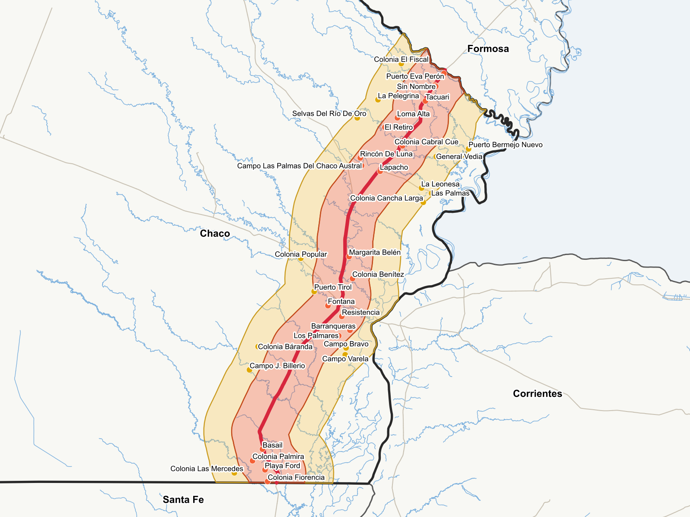
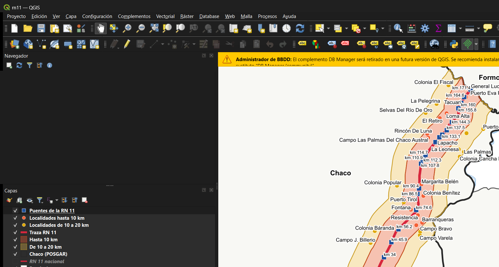
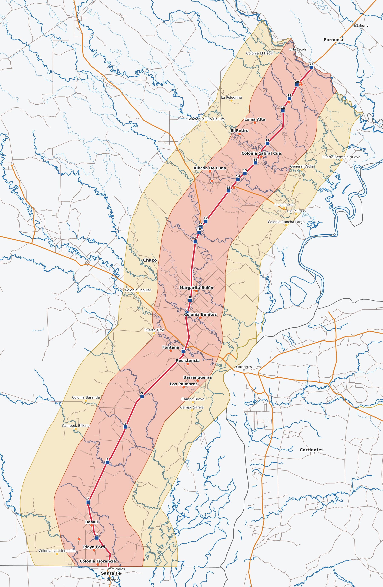
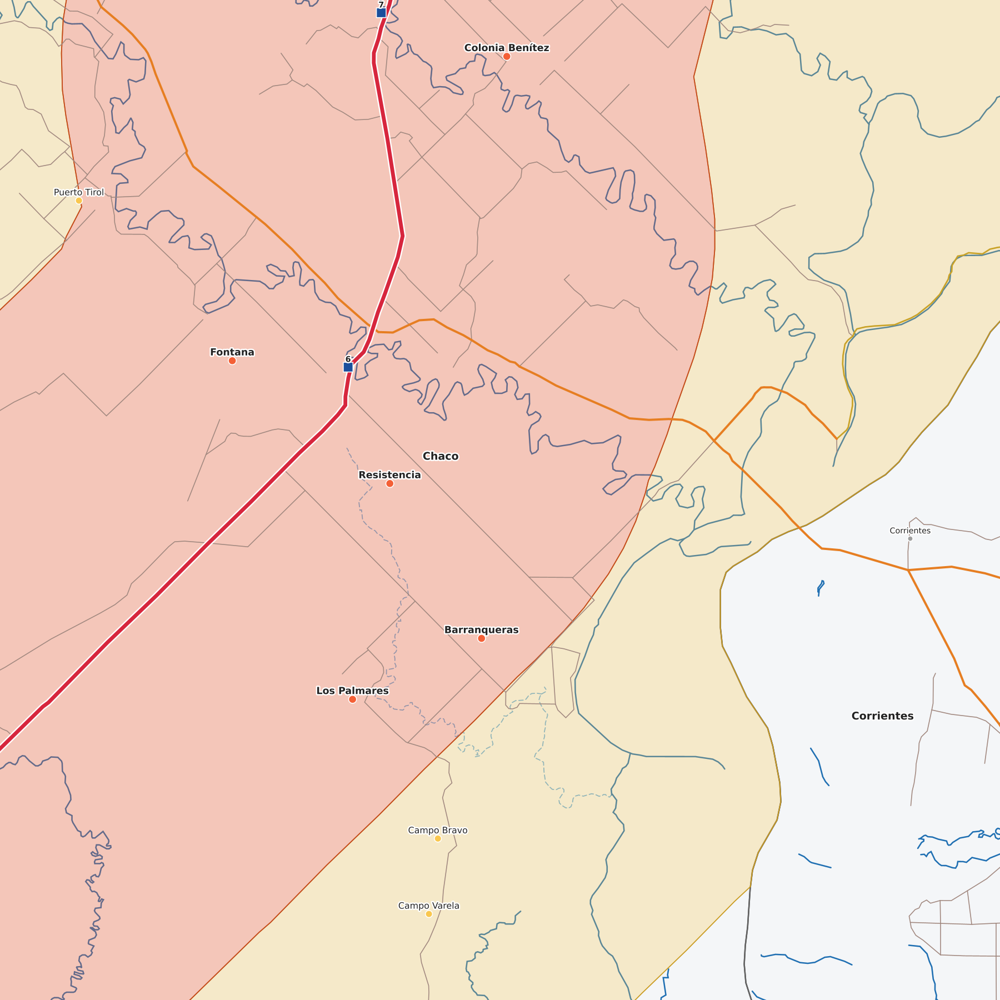
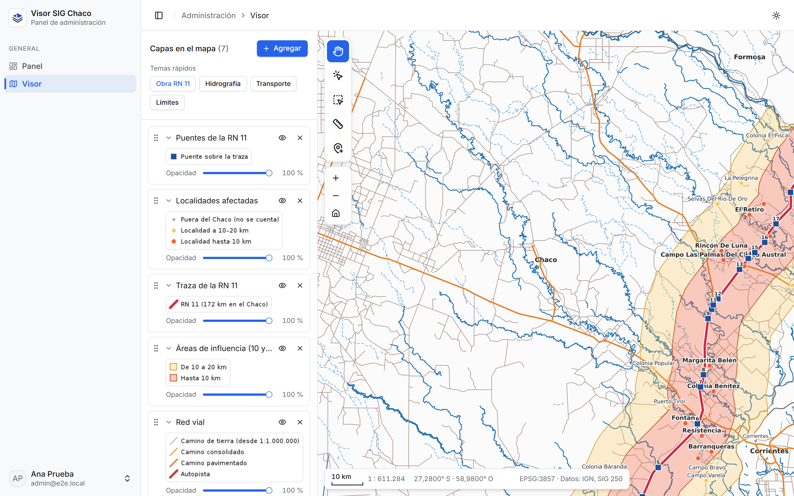
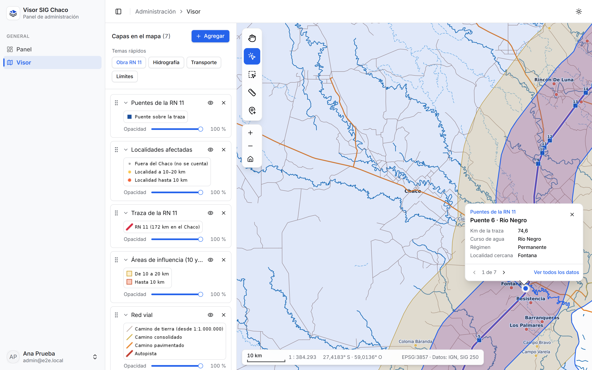
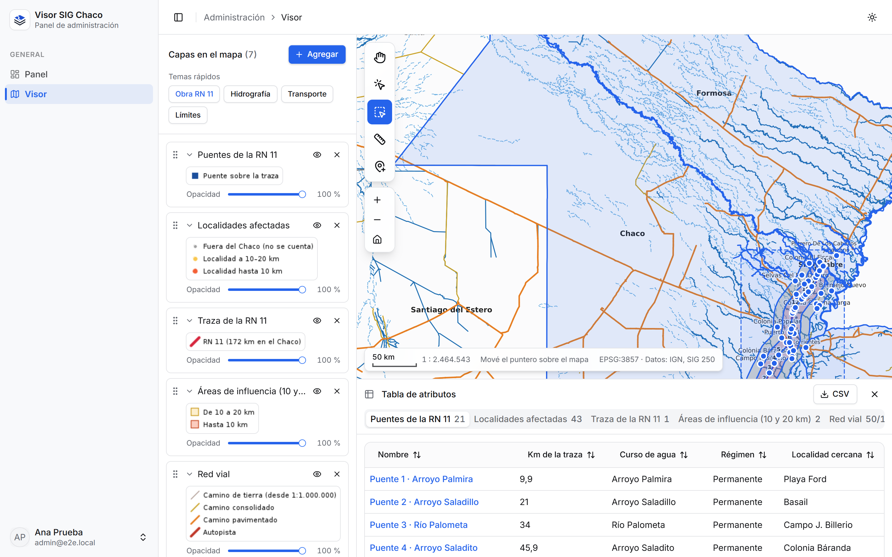

# Objetivo y escenario

El Ministerio de Planificación de la Nación prevé obras de mantenimiento en la traza de la **Ruta Nacional 11 (RN 11)** dentro de la Provincia del Chaco. Para justificar la obra y preparar los pliegos de licitación, la consigna b del Trabajo Práctico Integrador pide tres datos:

1. Cuántos kilómetros tiene la traza de la ruta en la provincia.
2. A cuánta población afecta la obra de manera directa, en dos categorías excluyentes: la que vive **hasta 10 km** de la ruta y la que vive **hasta 20 km** (es decir, de 10 a 20 km).
3. Cuántos y cuáles puentes cruzan la traza en la provincia.

Este informe describe los pasos ejecutados, con capturas de cada uno, y presenta los resultados.

## Respuestas en síntesis

Tabla: Respuestas a la consigna b

{{tabla_resumen}}

# Datos y herramientas

## Capas utilizadas

Todas las capas provienen del **SIG IGN 250** del Instituto Geográfico Nacional, provisto por la cátedra (IGN, 2011). Están cargadas en PostGIS y publicadas por WMS y WFS en GeoServer (consignas a.1 y a.2).

Tabla: Capas del SIG IGN 250 usadas en el análisis

| Capa | Tabla PostGIS | Uso en el análisis |
|---|---|---|
| Provincias | `provincias` | Límite de la Provincia del Chaco para recortar |
| Red vial | `red_vial` | Traza de la RN 11 (`nro_ruta = '11'`, `administra = 'Nacional'`) |
| Localidades | `localidades` | Población por localidad (campo `canthab`) |
| Puentes de la red vial | `puente_red_vial_puntos` | Puentes sobre la traza |
| Cursos de agua | `curso_de_agua_hid` | Curso de agua que cruza cada puente y control |

## Sistema de referencia

Las capas están en coordenadas geográficas (WGS 84, EPSG:4326). Una distancia o un buffer en grados no representa kilómetros reales, así que todas las medidas se hacen en **POSGAR 2007 / Argentina faja 5** (EPSG:5347). Es el marco oficial de la Argentina, con unidades en metros y meridiano central en 60° O, que atraviesa el este del Chaco (IGN, s.f.; EPSG, s.f.). Para pasar de WGS 84 a POSGAR 2007 se usa la transformación de mayor precisión que ofrece QGIS (0,5 m).

## Herramientas

- **PostgreSQL 17 + PostGIS 3.5:** cálculo reproducible con SQL (`scripts/analisis_rn11.sql`).
- **QGIS 4.2.2:** los mismos pasos con algoritmos de Procesamiento, para validar el SQL y obtener las figuras (`scripts/analisis_rn11_qgis.py`).
- **GeoServer 2.27:** publica los resultados como capas WMS/WFS, que se ven en el visor web del proyecto.

El análisis se repite con dos comandos: `python scripts/analisis_rn11.py` en PostGIS y `scripts/analisis_rn11_qgis.py` con el Python de QGIS. Al final, el segundo compara sus números con los del primero.

# Metodología

## Paso 1. Extraer la RN 11 y recortarla al Chaco

En la red vial, el número de ruta **11** aparece con dos administraciones: la RN 11 (nacional, pavimentada) y la RP 11 (provincial, otra ruta, en gran parte de tierra). Se extraen solo los tramos con `nro_ruta = '11'` y `administra = 'Nacional'`, y se recortan con el polígono de la provincia.

```sql
SELECT ST_LineMerge(ST_CollectionExtract(
         ST_Intersection(ST_Union(ST_Transform(r.geom, 5347)), c.g), 2))
FROM red_vial r CROSS JOIN chaco c
WHERE r.nro_ruta = '11' AND r.administra = 'Nacional';
```

En QGIS: *Extraer por atributo* (provincia Chaco), *Extraer por expresión* (RN 11 nacional) y *Cortar*.



Figura: Paso 1 en QGIS. En rojo, la RN 11 nacional; en negro, el límite de la Provincia del Chaco.

## Paso 2. Reproyectar y medir la traza

La traza recortada se reproyecta a EPSG:5347, se disuelve y se fusiona en una sola línea (*Reproyectar capa*, *Disolver* y *Fusionar líneas*). El resultado es **una línea continua** entre el límite con Santa Fe y el río Bermejo (límite con Formosa), de **{{km_traza}} km**. El cálculo geodésico sobre el elipsoide da el mismo valor.



Figura: Paso 2 en QGIS. La traza de la RN 11 dentro del Chaco, medida en POSGAR 2007 faja 5.

## Paso 3. Áreas de influencia de 10 y 20 km

Las categorías de población son **excluyentes**, así que se usan dos áreas que no se superponen:

- **Hasta 10 km:** buffer de 10 km alrededor de la traza.
- **De 10 a 20 km:** anillo, que es el buffer de 20 km menos el de 10 km.

Las dos se recortan al Chaco. Ocupan {{area_10_km2}} km² y {{area_10_20_km2}} km², respectivamente.

```sql
ST_Buffer(traza, 10000, 'quad_segs=16')                         -- hasta 10 km
ST_Difference(ST_Intersection(ST_Buffer(traza, 20000), chaco),
              ST_Buffer(traza, 10000))                          -- de 10 a 20 km
```

En QGIS: *Buffer* (10 000 y 20 000 m, disuelto), *Cortar* con el Chaco y *Diferencia*.



Figura: Paso 3 en QGIS. En naranja, el área hasta 10 km; en amarillo, el anillo de 10 a 20 km.

## Paso 4. Localidades y población afectada

Se seleccionan las localidades **dentro** de cada área (*Extraer por localización*, predicado "está dentro") y se suma su población, que es el campo `canthab` de la capa del IGN. Esa cifra coincide con el Censo Nacional 2001 (INDEC, 2001); por ejemplo, Resistencia figura con 274 490 habitantes. Cada localidad cae en una sola categoría según su distancia a la traza.

Solo se cuentan las localidades cuyo atributo `provincia` es Chaco. Con el polígono solo, General Lucio V. Mansilla, de Formosa, quedaría adentro: está sobre el río Bermejo, que es el límite entre las dos provincias.



Figura: Paso 4 en QGIS. Localidades hasta 10 km (naranja) y de 10 a 20 km (amarillo).

## Paso 5. Puentes sobre la traza

La capa de puentes es de puntos y no indica a qué camino pertenece cada uno. Un puente se considera de la RN 11 si cumple dos condiciones:

1. está a **500 m o menos** de la traza (*Extraer dentro de una distancia*);
2. su **camino más cercano** es la RN 11 (*Unir atributos por el más cercano* con la red vial). Así se descartan los puentes de caminos vecinales que solo pasan cerca.

Con el primer criterio quedan 24 puntos; el segundo descarta 3 de caminos vecinales. Cada puente se ubica después por su **kilómetro sobre la traza** (`ST_LineLocatePoint`, desde el límite con Santa Fe), el **curso de agua** más cercano y la **localidad** más cercana.


Figura: Paso 5 en QGIS. Puentes de la RN 11, rotulados con su kilómetro sobre la traza.

## Validación entre PostGIS y QGIS

Los dos procedimientos llegan a los mismos valores:

Tabla: Comparación de resultados entre PostGIS y QGIS

{{tabla_validacion}}



Figura: Proyecto `docs/tpi/punto-b/qgis/rn11.qgz` abierto en QGIS 4.2.2 con las capas de cada paso.

# Resultados

## Longitud de la traza

La RN 11 recorre **{{km_traza}} km** dentro de la Provincia del Chaco.



Figura: Traza de la RN 11 en el Chaco con sus áreas de influencia, las localidades afectadas y los puentes (GeoServer, capas del análisis).

## Población afectada

Tabla: Población afectada por categoría (solo Provincia del Chaco)

{{tabla_poblacion}}

La obra afecta de manera directa a **{{poblacion_total}} habitantes**. La mayor parte de esa población está en el Gran Resistencia: Resistencia, Fontana y Barranqueras están a menos de 10 km de la traza.



Figura: Detalle del Gran Resistencia: la traza pasa a menos de 3 km del centro de la capital.

Tabla: Localidades del Chaco hasta 10 km de la traza

{{tabla_localidades_10}}

Tabla: Localidades del Chaco de 10 a 20 km de la traza

{{tabla_localidades_20}}

**Fuera del Chaco.** Dentro de los 20 km también hay localidades de otras provincias que no se cuentan, porque la consigna se refiere a la traza en el Chaco. Suman {{poblacion_fuera}} habitantes; la mayor es la ciudad de Corrientes, a unos 18 km, del otro lado del río Paraná.

Tabla: Localidades de otras provincias dentro de los 20 km (no se cuentan)

{{tabla_fuera}}

## Puentes sobre la traza

**{{puentes}} puentes** cruzan la traza de la RN 11 en el Chaco:

Tabla: Puentes de la RN 11 en el Chaco, desde el límite con Santa Fe

{{tabla_puentes}}

Para controlar, se contaron los cruces de la traza con la capa de cursos de agua: hay {{cruces}}. Diecinueve tienen un puente a menos de 1 km. El cruce del **Río de Oro** (km 141,7) no tiene un punto de puente en la capa del IGN. Los puentes 8 y 12 no tienen un curso de agua cartografiado cerca, probablemente porque cruzan cauces menores o canales que la escala 1:250 000 no representa.

# Resultados en el visor web

Los resultados también se publican como capas en GeoServer y se ven en el visor del proyecto con el tema rápido **Obra RN 11**. El Panel de Administración muestra los indicadores y las tablas, leídos directamente de PostGIS.



Figura: Visor web con el tema "Obra RN 11": traza, áreas, localidades y puentes numerados, con su leyenda.



Figura: Consulta por punto de un puente: el globo muestra su kilómetro, el curso de agua y la localidad cercana.



Figura: Consulta por rectángulo sobre el corredor: la tabla de atributos lista los puentes de la RN 11.

# Limitaciones

- **Fecha de los datos:** la población es la del Censo 2001 que trae la capa del IGN. Una actualización con el Censo 2022 elevaría los valores.
- **Localidades sin dato:** solo {{localidades_con_dato}} de las {{localidades_total}} localidades del Chaco dentro de los 20 km tienen población cargada. Las demás son parajes y colonias rurales sin dato, así que la población rural dispersa queda subestimada.
- **Localidades como puntos:** la distancia se mide al punto de cada localidad, no a su ejido. Una ciudad cuyo punto cae dentro de un área se cuenta completa en esa categoría.
- **Asignación de puentes:** el criterio del camino más cercano depende de la precisión de la escala 1:250 000. Un puente en el cruce de dos rutas podría asignarse a la otra ruta.

# Conclusión

La RN 11 recorre **{{km_traza}} km** en el Chaco, desde el límite con Santa Fe hasta el río Bermejo. La obra afecta de manera directa a **{{poblacion_0_10}} habitantes** que viven hasta 10 km de la ruta y a **{{poblacion_10_20}} habitantes** que viven de 10 a 20 km, **{{poblacion_total}}** en total. Esa población se concentra en el Gran Resistencia. **{{puentes}} puentes** cruzan la traza, casi todos sobre arroyos y ríos; el último, en el km {{km_ultimo_puente}}, es el del río Bermejo, en el límite con Formosa.

Los números se obtuvieron con dos herramientas independientes, PostGIS y QGIS, y coinciden. El procedimiento queda en scripts que cualquier integrante puede repetir.

# Referencias

- EPSG (s.f.). *EPSG:5347 – POSGAR 2007 / Argentina 5*. https://epsg.io/5347
- GeoServer (2025). *GeoServer 2.27 User Manual*. Open Source Geospatial Foundation. https://docs.geoserver.org/
- IGN – Instituto Geográfico Nacional (2011). *SIG IGN 250: capas vectoriales de información geográfica de la República Argentina, escala 1:250 000*. Provistas por la cátedra (enlace en la consigna). https://www.ign.gob.ar/
- IGN – Instituto Geográfico Nacional (s.f.). *Marco de Referencia Geodésico Nacional POSGAR 2007*. https://www.ign.gob.ar/
- INDEC – Instituto Nacional de Estadística y Censos (2001). *Censo Nacional de Población, Hogares y Viviendas 2001*. https://www.indec.gob.ar/
- Open Geospatial Consortium (2006). *OpenGIS Web Map Server Implementation Specification 1.3.0* (OGC 06-042). https://www.ogc.org/standards/wms
- Open Geospatial Consortium (2010). *OpenGIS Web Feature Service 2.0 Interface Standard* (OGC 09-025r1). https://www.ogc.org/standards/wfs
- PostGIS Project Steering Committee (2025). *PostGIS 3.5 Manual*: `ST_Buffer`, `ST_Difference`, `ST_Intersection`, `ST_LineLocatePoint`. https://postgis.net/docs/
- QGIS Development Team (2026). *QGIS User Guide: algoritmos de Procesamiento* (Buffer, Cortar, Diferencia, Extraer por localización, Unir atributos por el más cercano). https://docs.qgis.org/latest/es/docs/user_manual/processing_algs/qgis/
- UTN FRRe (2026). *Trabajo Práctico Integrador – Sistemas de Información Geográfica*. Ing. Ilse Hodapp e Ing. Rodrigo Valdés. `docs/tpi/practico.pdf`.
